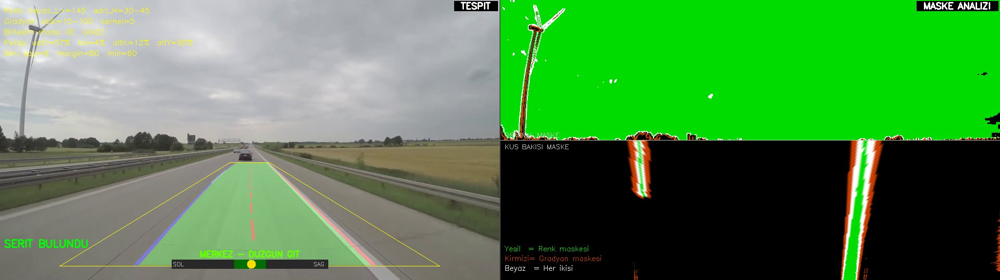
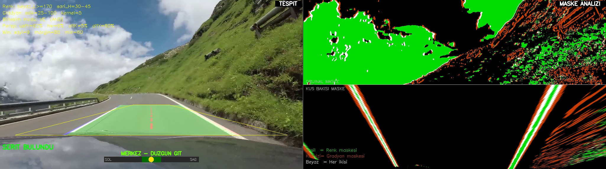
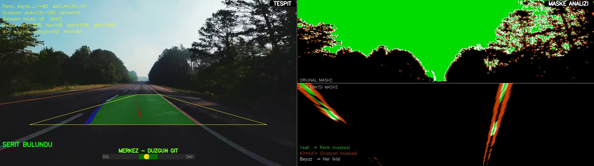
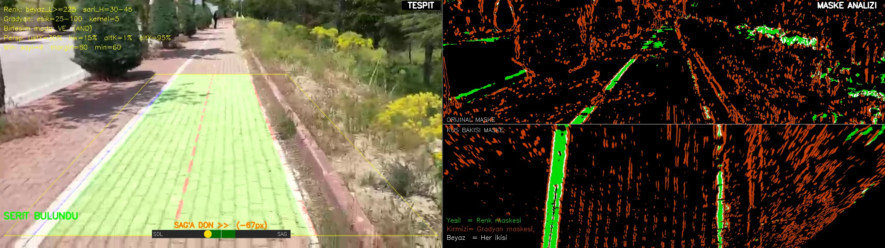
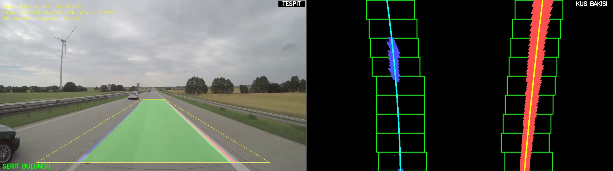
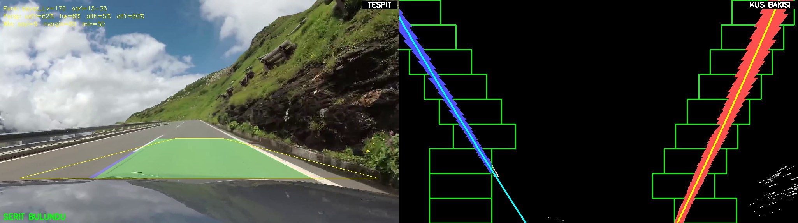
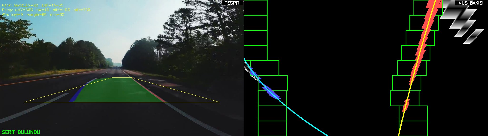
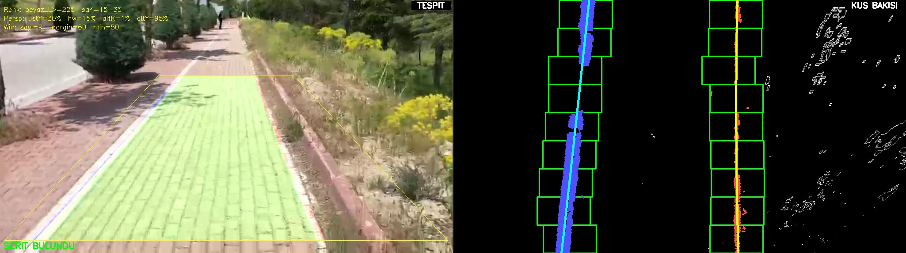
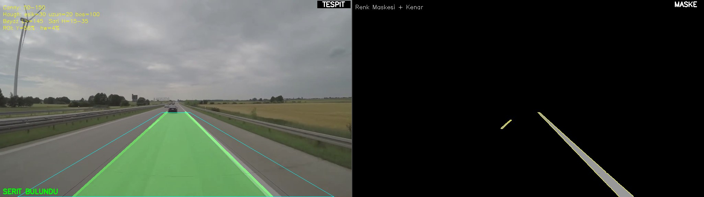
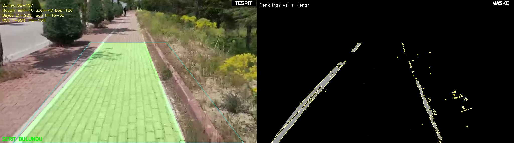

# Şerit Tespiti (Lane Detection)

Otonom kara aracı (UGV) için OpenCV tabanlı, gerçek zamanlı şerit tespiti. Aynı problem için üç farklı algoritma alternatifi bulunur. Hepsinde parametreler canlı **trackbar** penceresinden ayarlanabilir. İstenirse sonuçlar **ROS 2** üzerinden yayınlanabilir (ROS kurulu değilse kod otomatik olarak yalnızca OpenCV moduyla çalışır).

| Alternatif | Dosya | Yöntem |
|---|---|---|
| **Alt1**: Klasik | `alt1_hough_lines.py` | HLS renk filtresi → Canny kenar → trapez ROI → Probabilistic Hough → sol/sağ çizgi ortalaması |
| **Alt2**: Kayan Pencere | `alt2_sliding_window.py` | HLS renk maskesi → perspektif dönüşümü (kuş bakışı) → histogram + kayan pencere → 2. derece polinom |
| **Alt3**: Renk + Şekil | `alt3_color_shapeee.py` | HLS renk maskesi **VE/VEYA** Sobel-X gradyan maskesi → kuş bakışı → kayan pencere → polinom + direksiyon (sapma) göstergesi |

## Tahmin Ekran Görüntüleri

Aşağıdaki görüntüler, scriptlerin kendisi test videoları üzerinde çalıştırılırken ekrana çizdiği pencereden alındı. Her video için trackbar katsayıları ayrı ayrı ayarlandı (değerler aşağıdaki [Ayarlanan Katsayılar](#ayarlanan-katsayılar) bölümünde). Varsayılan değerler her yola uymuyor; doğru tespit için katsayıların o videonun ışığına ve kamera açısına göre ayarlanması gerekiyor.

### Alt3: Renk + Gradyan + Kuş Bakışı (en gelişmiş)

Sol panel: tespit edilen şerit alanı, perspektif trapezi (sarı) ve direksiyon göstergesi.
Sağ panel üst: orijinal maske. Sağ panel alt: kuş bakışı maske (Yeşil = renk, Kırmızı = gradyan, Beyaz = ikisi birden).

**Otoyol (road1)**


**Dağ yolu, araç kaputu görünüyor (road2)**


**Gölgeli, karanlık asfalt (road3)**


**Parke taşlı bisiklet yolu (road4)**


### Alt2: Kuş Bakışı + Kayan Pencere

Sağ panel: kuş bakışı ikili görüntü, kayan pencereler (yeşil), sol şerit pikselleri (mavi), sağ şerit pikselleri (kırmızı) ve uydurulan polinomlar.






### Alt1: Hough Lines

Sağ panel: ROI içindeki renk maskesi ve Canny kenarları.




> **Not:** Alt1 düz çizgi modeli kullandığı ve eğimi `|m| < 0.5` olan çizgileri elediği için, şeritlerin çok yatık göründüğü geniş açılı görüntülerde (ör. road3) ve kaputun yansıma yaptığı karelerde (road2) zorlanıyor. Bu durumlarda Alt2/Alt3 belirgin şekilde daha iyi sonuç veriyor.

## Kurulum

```bash
pip install -r requirements.txt
```

ROS 2 modu için ayrıca `rclpy`, `cv_bridge`, `sensor_msgs` ve `std_msgs` gerekir (`sudo apt install ros-<distro>-cv-bridge`).

## Çalıştırma

```bash
python alt3_color_shapeee.py road1.mp4   # video dosyası
python alt3_color_shapeee.py 0           # kamera 0
python alt3_color_shapeee.py             # varsayılan: kamera 0
```

`alt1_hough_lines.py` ve `alt2_sliding_window.py` de aynı şekilde çalıştırılır. İki pencere açılır:

- **Ayarlar** penceresi: tüm katsayılar için trackbar'lar (değişiklik anında uygulanır)
- **Görüntü** penceresi: sol panelde tespit sonucu, sağ panelde maske/kuş bakışı analizi

Çıkmak için `q` tuşuna basın.

> Test videoları (`*.mp4`) boyut ve telif nedeniyle repoya eklenmedi. Kendi yol videonuzu proje klasörüne koyup yolunu argüman olarak verebilirsiniz.

### ROS 2 modu

```bash
python alt3_color_shapeee.py --ros --source road1.mp4 --fps 25          # yerel pencere + yayın
python alt3_color_shapeee.py --ros --source 0 --no-gui                  # sadece yayın
```

Yayınlanan topic'ler:

| Topic | Tip | İçerik |
|---|---|---|
| `/lane/processed_image` | `sensor_msgs/Image` | Anotasyonlu kare (BGR8) |
| `/lane/processed_image/compressed` | `sensor_msgs/CompressedImage` | Aynı kare, JPEG |
| `/lane/data` | `std_msgs/String` | JSON: şerit katsayıları, `lanes_detected`, sapma, FPS |

## Ayarlanan Katsayılar

Ekran görüntülerinde kullanılan trackbar değerleri aşağıda. Listede olmayan trackbar'lar varsayılan değerinde bırakıldı.

**Alt3**

| Video | Beyaz L Min | Mod | Sobel Alt | Persp Üst Y % | Üst Yarıçap % | Alt Kenar % | Alt Y % | Margin | Min Piksel |
|---|---|---|---|---|---|---|---|---|---|
| road1 | 145 | VE | 15 | 58 | 4 | 12 | 95 | 80 | 60 |
| road2 | 170 | VE | 25 | 62 | 6 | 5 | 80 | 80 | 60 |
| road3 | 90 | VE | 25 | 57 | 4 | 10 | 75 | 60 | 30 |
| road4 | 225 | VE | 25 | 30 | 15 | 1 | 95 | 60 | 60 |

**Alt2:** Renk ve perspektif değerleri Alt3 ile aynı (road1 için `Min Piksel = 30`).

**Alt1**

| Video | Beyaz L Min | ROI Üst Y % | ROI Üst Yarıçap % | Hough Oy Eşiği | Min Çizgi Uzunluğu |
|---|---|---|---|---|---|
| road1 | 145 | 57 | 4 | 30 | 20 |
| road4 | 225 | 30 | 15 | 40 | 40 |

**Ayar ipuçları**

- **Beyaz L Min**: Bulutlu ya da karanlık videolarda şerit boyası parlak görünmez. Yol yüzeyinin L değerinin hemen üstüne çekin (road3'te 90, güneşli parke yolda 225).
- **Perspektif trapezi**: Sol panelde sarı trapezin kenarları, kendi şeridinizin iki çizgisine paralel oturmalı. Doğru ayarda kuş bakışı panelde şerit çizgileri dikey ve paralel görünür.
- **Mod VE (AND)**: Gökyüzü ve bitki örtüsü gibi gürültüyü en iyi bastıran mod budur. VEYA (OR) modu silik şeritlerde kapsamı artırır ama gürültüyü de artırır.
- Görüntünün alt kısmında araç kaputu varsa **Alt Y %** değerini kaputun üstünde kalacak şekilde düşürün.

## Proje Yapısı

```
.
├── alt1_hough_lines.py        # Alt1: Canny + Hough (+ opsiyonel ROS 2)
├── alt2_sliding_window.py     # Alt2: Kuş bakışı + kayan pencere (+ opsiyonel ROS 2)
├── alt3_color_shapeee.py      # Alt3: Renk + Sobel gradyan + kayan pencere (+ opsiyonel ROS 2)
├── lane_publisher.py          # Hough tabanlı bağımsız ROS 2 publisher düğümü
├── lane_updated/              # Modüler sürüm: işleme ve ROS katmanı ayrı
│   ├── lane_processor.py      #   saf görüntü işleme (ROS bağımlılığı yok)
│   ├── lane_ros_publisher.py  #   ROS 2 yayın katmanı
│   └── lane_node.py           #   giriş noktası (OpenCV veya --ros)
├── docs/screenshots/          # README görselleri
└── requirements.txt
```
